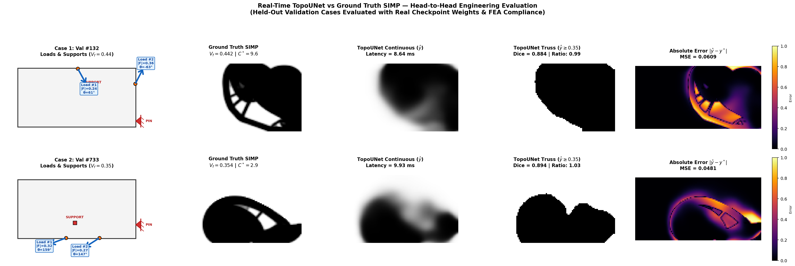
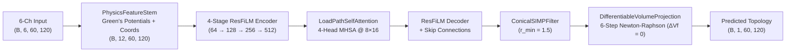

# Real-Time Structural Topology Optimization via Physics-Induced Deep Learning & SIMP-Judge RL

[](https://www.python.org/downloads/)
[](https://pytorch.org/)
[](https://opensource.org/licenses/MIT)

An end-to-end physics-informed computational mechanics and deep learning framework for **2D Continuum & Truss Structural Topology Optimization**. This repository combines a multi-core **Solid Isotropic Material with Penalization (SIMP)** finite element engine (with active in-plane Euler buckling sensitivity) and an **8.74M-parameter Physics-Induced U-Net (`TopoUNet` / `PI-UNet`)** fine-tuned inside a differentiable **SIMP-Judge Reinforcement Learning (RL) Environment** to predict mechanically stable, load-bearing structures in real time (**$< 10\text{ ms}$ on GPU**, **$> 1,700\times$ faster** than iterative FEA).

---

## Key Highlights & Quantitative Milestones

| Milestone | Method / Module | Key Metric / Result |
| :--- | :--- | :--- |
| **Phase 1: Unified SIMP & Buckling Solver** | `simp_solver.py` | $120 \times 60$ $Q_4$ mesh ($14,762$ DOFs); $89.5\%\text{–}93.7\%$ compliance reduction; up to **$+122.1\%$ buckling factor ($\lambda_1$) gain** on arch/bridge trusses |
| **Phase 2: 3,000-Sample Dataset & `TopoUNet`** | `dataset_generator.py`, `unet_model.py` | 6-channel physics tensor representation; Green's function potential stem, `ResFiLM` blocks, 4-head bottleneck self-attention, and exact Newton-Raphson volume projection ($\Delta V_f = 0.0000$) |
| **Phase 3: Physics-Aware Binarization** | `losses.py` (`physics_aware_binarize`) | Anchor/load-pad locking + sensitivity-filtered OC condensation + diagonal hinge bridging raises 100-sample structural stability from **$62.0\% \to 81.0\%$** |
| **Phase 4: SIMP-Judge RL Fine-Tuning** | `losses_rl_ver.py`, `train_unet_rl_ver.py` | Multi-threaded sparse FEA critic + White Top-Hat thin-strut skeleton weighting + 1-step OC distillation achieves **$95.0\%$ overall structural stability** ($100\%$ connectivity, **$1.01\times$ median compliance ratio**) |
| **Phase 5: Real-Time Inference Speedup** | `predict_unet.py`, `demo_server.py` | **$8.6\text{–}11.3\text{ ms}$** GPU forward pass vs. $\sim 18.2\text{ s}$ for 80-iteration SIMP (**$> 1,700\times$ speedup**) |

---

## Visual Overview

### 1. 4-Way Side-by-Side Generalization on Unseen Beams ($F = 1,500\text{ N}$, Structural Steel A36)
Comparison of **(1) Unoptimized Uniform Block**, **(2) 80-Iteration Classical SIMP**, **(3) Baseline U-Net (Naive $\hat{\rho} \ge 0.35$)**, and **(4) SIMP-Judge RL U-Net (`best_unet_rl.pth`)**:


### 2. 100-Sample Random Structural Stability & Breakage Audit (`95.0%` Stable)


### 3. Held-Out Validation Evaluation: `TopoUNet` vs. Ground-Truth SIMP


### 4. Pure Compliance SIMP vs. Active Buckling-Aware SIMP


---

## Repository Structure

```text
topo_opto/
├── simp_solver.py                    # Phase 1: Unified 2D Q4 FEA, Von Mises stress, geometric stiffness KG & SIMP solver
├── dataset_generator.py              # Phase 1: Multi-core parallel SIMP dataset generator with Sosnovik Poisson fixtures
├── dataset.py                        # Phase 2: PyTorch Dataset & DataLoaders with vector-preserving reflections
├── unet_model.py                     # Phase 2: 8.74M parameter TopoUNet (PhysicsFeatureStem, ResFiLM, Self-Attention, VolProj)
├── losses.py                         # Phase 2/3: Physics composite loss, exact nodal BC reconstruction, stability inspector
├── losses_rl_ver.py                  # Phase 4: SIMP-Judge RL environment, self-adjoint FEA critic, White Top-Hat thin-strut loss
├── train_unet.py                     # Phase 2: Supervised physics-guided GPU training pipeline (AMP FP16, TF32, Cosine LR)
├── train_unet_rl_ver.py              # Phase 4: SIMP-Judge RL & self-adjoint physics fine-tuning pipeline
├── evaluate_stability_100.py         # Phase 3/4: 100-sample structural stability & breakage benchmark (connectivity, FEA, FoS, λ₁)
├── compare_new_beams_side_by_side.py # Phase 5: 4-way generalization benchmark on newly generated beams under 1500 N load
├── generate_validation_comparison.py # Phase 3: Held-out validation evaluator & 6-panel / 2x5 publication figure generator
├── predict_unet.py                   # Phase 2: Full-dataset inference latency benchmark & 5-panel comparison plotter
├── visualize_data.py                 # Phase 1/2: Engineering drawing primitives (pins, rollers, load vectors, scorecards)
├── visualize_unet.py                 # Phase 2/3: 5-mode diagnostic suite (comparison, sweep_vf, sweep_threshold, stress, batch)
├── interactive_demo.py               # Phase 2: Fast CLI benchmark & dataset sample runner
├── demo_server.py                    # Phase 2: Zero-dependency browser web application for real-time interactive design
├── checkpoints/
│   ├── best_unet.pth                 # Baseline TopoUNet production weights (trained 50 epochs on 3,000 samples)
│   ├── best_unet_rl.pth              # SIMP-Judge RL fine-tuned TopoUNet weights (95% stability accuracy)
│   ├── training_curves.png           # Baseline 50-epoch training & validation loss/Dice curves
│   ├── training_curves_rl.png        # SIMP-Judge RL fine-tuning trajectory curves
│   ├── training_history.json         # Full 50-epoch supervised training log
│   ├── training_history_rl.json      # SIMP-Judge RL training log
│   ├── stability_100_report.json     # 100-sample baseline stability audit report
│   ├── stability_100_rl_report.json  # 100-sample SIMP-Judge RL stability audit report (95% pass rate)
│   └── new_beams_4way_report.json    # Quantitative report for the 4-way unseen beam generalization study
├── images/                           # Generated benchmark, stability, and validation visualizations
├── topo_dataset_3000.npz             # 3,000-sample verified SIMP ground-truth dataset (6-ch inputs, targets, strain energy)
├── topo_dataset_1000.npz             # 1,000-sample subset archive
├── experiment.md                     # Detailed experimental log, root-cause failure analysis, and RL ablation study
├── handover.md                       # Complete architectural reference & mathematical derivations
├── workingnotes.md                   # Variable catalog & Phase 1 benchmark verification log
└── topo_opti_project.pdf             # Project specification document
```

---

## Mathematical & Architectural Formulation

### 1. Standardized 6-Channel Tensor Representation
Every structural problem on the $N_y \times N_x = 60 \times 120$ bilinear quadrilateral ($Q_4$) mesh is encoded as a 6-channel spatial tensor $\mathbf{X} \in \mathbb{R}^{6 \times 60 \times 120}$ paired with converged SIMP density $\boldsymbol{\rho}^* \in [0, 1]^{60 \times 120}$ and element strain energy $e_e = \mathbf{u}_e^T \mathbf{K}_e \mathbf{u}_e$:

| Channel | Name | Shape | Physical Meaning |
| :---: | :--- | :---: | :--- |
| `0` | `ch_domain` | $(60, 120)$ | Active design domain mask ($1.0 = \text{optimizable continuum}$) |
| `1` | `ch_bc_x` | $(60, 120)$ | Horizontal displacement constraint mask ($U_x = 0$) |
| `2` | `ch_bc_y` | $(60, 120)$ | Vertical displacement constraint mask ($U_y = 0$) |
| `3` | `ch_fx` | $(60, 120)$ | Horizontal applied nodal force component $F_x$ |
| `4` | `ch_fy` | $(60, 120)$ | Vertical applied nodal force component $F_y$ |
| `5` | `ch_vf` | $(60, 120)$ | Uniform target volume fraction field $V_f \in [0.22, 0.55]$ |

### 2. `TopoUNet` (`PI-UNet`) Architecture (`unet_model.py`)


### 3. SIMP-Judge RL & Self-Adjoint Physics Environment (`losses_rl_ver.py`)
To eliminate thin-strut erosion and pinch-point hinges that occur under purely pixel-supervised training, `SIMPJudgeEnvironment` places a multi-threaded sparse $Q_4$ FEA solver directly inside the training loop:
1. **Self-Adjoint Compliance Gradient:**
   $$\frac{\partial C}{\partial \hat{\rho}_e} = -p(E_0 - E_{\min})\tilde{\rho}_e^{p-1}\left(\mathbf{u}_e^T \mathbf{K}_0 \mathbf{u}_e\right)$$
   filtered through Sigmund's conical sensitivity operator $\mathbf{H}$ ($r_{\min}=1.5$).
2. **Online 1-Step Optimality Criteria (OC) Teacher (`rho_judge`):** Computes a volume-preserving 1-step OC update $\boldsymbol{\rho}_{\text{judge}} = \text{OC}_1(\hat{\boldsymbol{\rho}}, \widehat{\nabla C})$ as a dense step-wise trajectory target.
3. **White Top-Hat Thin-Strut Detector:** Isolates thin $2\text{–}4$ pixel internal bracing bars via morphological opening difference $\text{TopHat}_5(\boldsymbol{\rho}^*) = \text{clamp}(\boldsymbol{\rho}^* - \delta_5(\varepsilon_5(\boldsymbol{\rho}^*)), 0, 1)$ and upweights them by $3.5\times$.
4. **RL Stability Reward & Advantage Weighting:**
   $$R_i = \exp\left(-0.75 \max\left(0, \frac{C(\hat{\boldsymbol{\rho}}_i)}{C_i^*} - 1.0\right)\right), \quad A_i = 1.0 + 2.5(1.0 - R_i) \in [1.0, 3.5]$$

---

## Quickstart & Execution Guide

### Prerequisites
```bash
pip install numpy scipy matplotlib torch
```

### 1. Interactive Web Application (`demo_server.py`)
Launch the zero-dependency browser UI with real-time `TopoUNet` inference and live SIMP comparison:
```bash
python demo_server.py --port 5000 --checkpoint checkpoints/best_unet_rl.pth --dataset topo_dataset_3000.npz
```
Then open `http://127.0.0.1:5000` in your browser.

### 2. 100-Sample Structural Stability & Breakage Audit (`evaluate_stability_100.py`)
Evaluate topological load-path connectivity, FEA compliance ratio ($\le 2.5\times$), Von Mises yield safety ($\text{FoS} \ge 1.0$), and Euler buckling stability ($\lambda_1 \ge 1.0$):
```bash
# Evaluate SIMP-Judge RL checkpoint (95.0% overall stability)
python evaluate_stability_100.py --dataset topo_dataset_3000.npz --checkpoint checkpoints/best_unet_rl.pth --polish_steps 5

# Evaluate Baseline checkpoint
python evaluate_stability_100.py --dataset topo_dataset_3000.npz --checkpoint checkpoints/best_unet.pth --polish_steps 2
```

### 3. 4-Way Generalization Comparison on Unseen Beams (`compare_new_beams_side_by_side.py`)
Run the 4-way side-by-side comparison (Unoptimized Block vs. 80-Iter SIMP vs. Baseline U-Net vs. SIMP-Judge RL U-Net) under a $1,500\text{ N}$ working load:
```bash
python compare_new_beams_side_by_side.py
```

### 4. Multi-Mode U-Net Diagnostic Suite (`visualize_unet.py`)
```bash
# Mode 1: 6-panel engineering comparison (BCs, SIMP, Continuous, Binarized, Error, Histogram)
python visualize_unet.py --mode comparison --sample_idx 132 --checkpoint checkpoints/best_unet_rl.pth

# Mode 2: Real-time Volume Fraction parameter sweep (Vf = 0.25, 0.35, 0.45, 0.55)
python visualize_unet.py --mode sweep_vf --case cantilever --checkpoint checkpoints/best_unet_rl.pth

# Mode 3: Binarization threshold sensitivity operating curve
python visualize_unet.py --mode sweep_threshold --sample_idx 733 --checkpoint checkpoints/best_unet_rl.pth

# Mode 4: 2D plane-stress Von Mises recovery & Factor of Safety verification
python visualize_unet.py --mode stress --sample_idx 132 --material steel --force 1500

# Mode 5: Batch statistical scorecard
python visualize_unet.py --mode batch --dataset topo_dataset_3000.npz --num_samples 100
```

### 5. Phase 1 Unified SIMP & Active Buckling Solver (`simp_solver.py`)
```bash
# Pure compliance SIMP vs. Buckling-Aware SIMP head-to-head comparison
python simp_solver.py --case bridge --volfrac 0.35 --compare-buckling --buckle-weight 0.45 --max-iter 50
```

### 6. Dataset Generation & Model Training (`dataset_generator.py`, `train_unet.py`, `train_unet_rl_ver.py`)
```bash
# 1. Generate SIMP dataset in parallel across CPU cores
python dataset_generator.py --num_samples 3000 --output topo_dataset_3000.npz --cores 12 --max_iter 80

# 2. Train baseline TopoUNet (50 epochs, AMP FP16)
python train_unet.py --dataset topo_dataset_3000.npz --epochs 50 --batch_size 32 --lr 1e-3

# 3. Fine-tune TopoUNet with SIMP-Judge RL environment
python train_unet_rl_ver.py --dataset topo_dataset_3000.npz --resume checkpoints/best_unet.pth --epochs 6 --batch_size 16 --judge_workers 8
```

---

## Documentation & Reports

- **[`experiment.md`](experiment.md)**: Complete experimental log for Phases 3–5, root-cause failure diagnosis, and SIMP-Judge RL ablation benchmarks.
- **[`handover.md`](handover.md)**: End-to-end technical architecture, 6-channel tensor specification, and FEA compliance benchmarks.
- **[`workingnotes.md`](workingnotes.md)**: Complete catalog of physical variables and Phase 1 SIMP + Buckling benchmark tables.

---

## Authors & Team Members

- **Aditya Amodkar** (CE23BTECH11004)
- **Ayush Dhakad** (CE23BTECH11010)
- **Pushpraj Singh Khichi** (CE23BTECH11043)
- **Vedant Gupta** (CE23BTECH11059) — [vedantgupta070@gmail.com](mailto:vedantgupta070@gmail.com)

GitHub Repository: [https://github.com/wiesard-g12/topology_optimisation/tree/new](https://github.com/wiesard-g12/topology_optimisation/tree/new)
